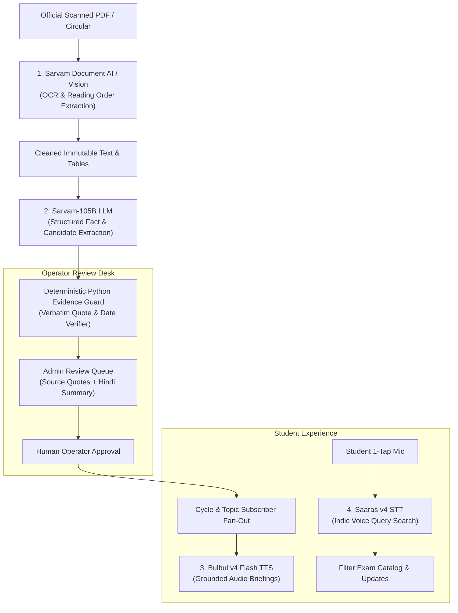

# NiyamPulse

<div align="center">

**Official Indian Exam Updates, Clearly Explained & Grounded in Source Evidence.**

*An intelligent, multilingual exam notification & intelligence platform for Indian school students and engineering aspirants.*

[](#testing--verification)
[](https://www.python.org/)
[](https://fastapi.tiangolo.com/)
[](https://react.dev/)
[](https://www.typescriptlang.org/)
[](https://www.sarvam.ai/)
[](https://sqlite.org/)

</div>

---

## 1. The Problem We Are Solving

Every year, over **30 million Indian students and engineering aspirants** prepare for high-stakes competitive examinations such as **JEE Main, NEET UG, GATE, UPSC ESE, NDA, and SSC JE**.

Despite the importance of these exams, official communications remain broken:
1. **Opaque, Scanned Circulars**: Exam bodies (like NTA and UPSC) frequently publish critical announcements as low-resolution scanned image PDFs with complex Devanagari/English tables and blurred official stamps.
2. **Social Media Rumors & Clickbait**: Aspirants are misled by sensationalized videos and unverified blogs predicting speculative dates, causing severe exam anxiety.
3. **Overlooked Deadlines & Eligibility Changes**: A minor official corrigendum modifying age cut-offs, reservation criteria, or closing dates can disqualify an eligible student who missed an update buried inside a government portal.
4. **Language & Accessibility Barriers**: Millions of students from rural and semi-urban areas understand Hindi and regional languages better, yet official notices are predominantly published in dense, bureaucratic English legal prose.

---

## 2. What NiyamPulse Does

**NiyamPulse** bridges this information divide with automated intelligence, cryptographic provenance, and human-in-the-loop review:

- **Zero-Friction Watchlists**: Students follow the exam cycles they care about (e.g., *JEE Main 2027 Session 1*, *NEET UG 2027*, *GATE 2027*) without uploading personal documents or sharing private marks.
- **Genuine Source Monitoring**: Background workers monitor allowlisted government announcement pages (`.gov.in`, `.nic.in`), capturing notices with cryptographic provenance (SHA-256 byte digests).
- **Sarvam AI Indic Extraction**: Recovers text from scanned circulars (Document AI), structures key facts and dates (Sarvam-105B), and generates controlled Hindi summaries.
- **Strict Human-in-the-Loop Review**: No alert is dispatched to students without an operator reviewing the exact source quote and verification evidence.
- **Accessible Voice Search & Audio Narration**: 1-tap voice inquiry (Saaras v4) and audio readouts (Bulbul v4 Flash) with mathematical date guards.

---

## 3. Core Architectural Invariant

```
┌─────────────────────────────────────────────────────────────┐
│                    THE NIYAMPULSE INVARIANT                 │
│                                                             │
│   "LLM extracts and explains; deterministic Python code     │
│    decides. AI proposes candidates; code proves evidence."  │
└─────────────────────────────────────────────────────────────┘
```

1. **Deterministic Rule Evaluator**: AI models are *never* allowed to compute eligibility decisions, invent dates, or approve notices. Final numbers and decision states (`PASS`, `FAIL`, `UNKNOWN`, `CONFLICT`) are calculated purely by deterministic Python code.
2. **Cryptographic Source Lineage (SourceGate)**: We never rely on simple hostname checks. Every document has an immutable raw snapshot stored with its SHA-256 byte digest, observed listing URL, acquisition timestamp, and publisher ancestry.
3. **Zero Fabricated Data**: No synthetic users, fake delivery percentages, or unverified counters exist in the production database (`var/production/niyampulse.sqlite3`). Real counters derive directly from SQLite SQL aggregates.
4. **Anti-Hallucination Evidence Anchoring**: Every fact extracted by Sarvam-105B must match the raw source document verbatim. If an LLM invents a word, changes a date, or alters an eligibility number, it is instantly rejected (`GUARD_REJECTED`).
5. **No Blind Update Dispatch**: Notices pass through SourceGate and Human Review before creating private student inbox notifications.

---

## 4. How Sarvam AI Powers NiyamPulse

NiyamPulse integrates all four pillars of the **Sarvam AI** stack into an end-to-end, safety-guarded pipeline:



### 1. Sarvam Document AI / Vision (Scanned Indic OCR)
- Recovers Devanagari and English text from flat, low-resolution scanned government circulars.
- Reconstructs natural reading orders and linearizes complex government circular tables into clean, readable text.
- Permanent SQLite caching (`v2_ai_cache`) ensures zero duplicate scans and protects credits.

### 2. Sarvam-105B (Structured Extraction & Hindi Summaries)
- Extracts typed topics (`REGISTRATION`, `EXAM_SCHEDULE`, `ADMIT_CARD`, `RESULTS`, `SYLLABUS`), key dates, and exact verbatim quotes using strict JSON schemas.
- Generates controlled Hindi summaries (`HINDI_TOPICS`) alongside verbatim source quotes for regional language learners.
- Verified character-by-character by `validate_candidate()` against the raw source text.

### 3. Bulbul v4 Flash (Guarded Audio Briefings / TTS)
- Converts approved notice summaries into natural Hindi (`hi-IN`) and Indian English (`en-IN`) speech for mobile students and accessibility.
- **Mathematical Date & Number Guard**: Before text is passed to Bulbul, regex extraction verifies:
  $$\text{numbers}(\text{audio\_text}) \subseteq \text{numbers}(\text{official\_source\_evidence})$$
  If a number or date in the speech text lacks literal source backing, audio generation is **blocked immediately**.

### 4. Saaras v4 (Accessible Indic Voice Search / STT)
- 1-tap voice inquiry in Hindi, Hinglish, or English (*"JEE Main registration last date kab hai?"*).
- Accurately transcribes mixed Indic speech and maps it to target exams in the catalog.
- Hybrid architecture combines browser Web Speech API for instant zero-latency queries with cloud Saaras processing.

### 5. Credit Reserve & Safety Architecture
- Bounded budget tracking in `v2_ai_budget`.
- Conservative 500 paise (₹5.00) reservation ledgers in `v2_ai_calls`.
- Inviolable 500-credit floor in `v2_credit_reserve` with 15-minute validity snapshots, guaranteeing that automated jobs never deplete organization reserves.

---

## 5. Complete Feature Overview

| Feature | For Students & Administrators | Technical Details |
| :--- | :--- | :--- |
| **Multi-Exam Subscription Engine** | Pick your exams (JEE Main, NEET UG, NDA, GATE, UPSC ESE, SSC JE) and your specific year/session. No marksheets, DOB, or sensitive data required. | Declarative JSON catalog (`config/exam_catalog.json`). Subscriptions stored in SQLite (`v2_subscriptions`) with uniqueness constraint on `(user_id, cycle_id)`. Deduplicated fanout backfills approved updates. |
| **Real-Time Source Watcher** | Digital watchdog checking official government portals (NTA, UPSC) continuously, finding official circulars before news outlets do. | Asynchronous `SourceMonitor` and `SourceScheduler` with per-source isolation and robots.txt compliance. Validates official hostnames and computes SHA-256 byte digests. PyMuPDF extracts text locally on CPU at zero cost. |
| **Deterministic Rule Evaluator** | If an exam changes rules (e.g. minimum marks or age limits), the system checks your profile and confirms whether you qualify with 100% mathematical certainty—never an AI guess. | Pure Python rule engine supporting 5 closed types: `minimum_marks`, `maximum_income_inr`, `application_deadline`, `age_bounds`, `required_documents`. Four discrete decision states: `PASS`, `FAIL`, `UNKNOWN`, `CONFLICT`. Transactional rollback in SQLite. |
| **Human Review Desk** | A human operator reviews every AI-extracted notice, verifying the dates and official links before any student is notified. | Protected FastAPI endpoint `/api/v2/admin/notices/{id}/review`. Compares immutable candidate evidence, verified spans, and Sarvam Hindi summaries. Optimistic revision locking prevents concurrent update conflicts. |
| **1-Tap Voice Search** | Tap the mic, speak your question in Hindi, Hinglish, or English, and tap stop—it searches the official exam list instantly. | Hybrid Web Speech API (`SpeechRecognition`) + Sarvam Saaras v4 (`speech-to-text`). Captures 16kHz mono PCM WAV, aliases common terms (e.g., "जेईई" $\rightarrow$ `jee-main`), and immediately triggers search. |
| **Guarded Audio Readouts** | Listen to any verified notice summary read aloud in clear Hindi or Indian English on your phone. | Sarvam Bulbul v4 Flash endpoint `/api/v2/me/notifications/{id}/audio`. Enforces strict regex number and date guards before audio generation; caches WAV assets in SQLite. |
| **Enterprise Account Security** | Real student logins with secure password reset emails and privacy controls. No fake accounts or demo shortcuts. | Argon2id password hashing, single-use SHA-256 email action tokens, HttpOnly revocable session cookies, strict CORS/CSRF headers, rate limiting, and server-side role separation (`USER` vs `ADMIN`). |

---

## 6. Technology Stack

```
Frontend:
  • React 19 + TypeScript 5.8
  • Vite 6.4 (Production build in 1.78s)
  • Tailwind CSS v4 + Editorial Paper/Ink Design System
  • Lucide React Icons

Backend:
  • Python 3.12 (Native Windows & Linux compatible)
  • FastAPI (Strict OpenAPI contracts)
  • SQLite 3 with WAL (Write-Ahead Logging) and Foreign Key constraints
  • Pydantic v2 (Strict validation models in backend/schemas.py)
  • PyMuPDF (fitz) for zero-cost CPU digital PDF extraction
  • httpx for resilient asynchronous HTTP/REST calls
  • argon2-cffi for enterprise password hashing

AI & Speech Services:
  • Sarvam Document AI / Vision (Scanned Indic OCR)
  • Sarvam-105B (Indic Fact Extraction & Controlled Hindi Summaries)
  • Sarvam Saaras v4 (Speech-to-Text)
  • Sarvam Bulbul v4 Flash (Text-to-Speech)
```

---

## 7. Quickstart & Local Installation

### Prerequisites
- Python 3.12
- Node.js LTS (v20+ or v24)
- Git

### Installation Steps

1. **Clone the repository**:
   ```bash
   git clone https://github.com/AkshatPal2007/NiyamPulse-LIVE.git
   cd NiyamPulse-LIVE
   ```

2. **Set up Python Virtual Environment**:
   ```powershell
   python -m venv .venv
   .\.venv\Scripts\Activate.ps1
   python -m pip install -r requirements-production.lock.txt -r requirements-dev.txt
   ```

3. **Install Frontend Dependencies & Build**:
   ```powershell
   npm --prefix frontend ci
   npm --prefix frontend run build
   ```

4. **Configure Environment Variables**:
   Copy `.env.example` to `.env`:
   ```dotenv
   SARVAM_API_KEY=your_sarvam_api_key_here
   SMTP_HOST=smtp.gmail.com
   SMTP_PORT=587
   SMTP_SECURITY=starttls
   SMTP_USERNAME=your_email@gmail.com
   SMTP_PASSWORD=your_gmail_app_password
   SMTP_FROM=your_email@gmail.com
   ```

5. **Start the Application**:
   ```powershell
   python -m backend.serve
   ```
   Open **http://127.0.0.1:8000/** in your browser.

---

## 8. Testing & Verification

The repository contains an exhaustive automated test suite covering API contracts, deterministic rule evaluation, Sarvam mock transports, and security boundaries:

```powershell
# Run the full test suite
python -m pytest -q

# Verify Pydantic schema generation
python -m backend.schemas

# Check dependency integrity
python -m pip check

# Export OpenAPI schema & generate TypeScript types
python -m scripts.export_openapi
npm --prefix frontend run types
```

### Verified Test Results:
- **217 passed, 38 subtests passed** (0 failures).
- Complete contract integrity across Python and TypeScript.
- Real production database (`var/production/niyampulse.sqlite3`) contains **13 genuine official discoveries, 22 raw snapshots, 16 extractions, 1 real human-approved UPSC update, and zero fabricated users**.

---

## 9. Real-World Impact

NiyamPulse transforms the high-stress experience of competitive exam preparation in India. By combining **genuine government source monitoring**, **Sarvam AI’s cutting-edge Indic language models**, and a **deterministic, evidence-first safety architecture**, NiyamPulse ensures that no student ever misses their dream opportunity due to an overlooked notice, a language barrier, or an internet rumor.

---

## 10. License & Disclaimer

*Disclaimer: Decision support only; not official eligibility or application confirmation. NiyamPulse is independent of exam organizers. Refer to the original notice for authoritative information.*
