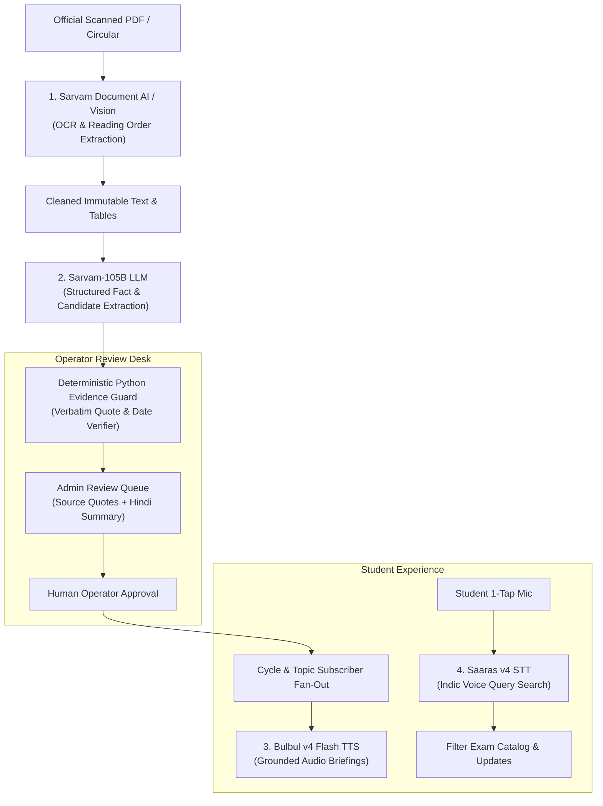

# NiyamPulse — Official Submission Documentation

> **Official Exam Updates, Clearly Explained & Grounded in Source Evidence.**  
> *A Multilingual Exam Intelligence & Notification Platform for Indian School Students and Engineering Aspirants.*

---

## 1. Executive Summary & Problem Statement

### The Problem in India
Across India, students and engineering aspirants prepare for competitive examinations such as **JEE Main, NEET UG, GATE, UPSC ESE, NDA, and SSC JE**. 

Despite the importance of these exams, official communications remain notoriously broken:
1. **Opaque, Scanned Circulars**: Exam bodies (like NTA and UPSC) frequently release critical announcements as low-quality scanned image PDFs with complex Devanagari/English tables and blurred stamps.
2. **Clickbait & Social Media Rumors**: Aspirants are bombarded with sensationalized YouTube videos and unverified coaching center blogs predicting "confirmed dates", causing severe exam anxiety.
3. **Overlooked Deadlines & Eligibility Tweaks**: A minor corrigendum changing qualifying marks, age cut-off dates, or application closing times can disqualify an eligible student who missed a 1-page update buried on a government portal.
4. **Language & Accessibility Barriers**: Millions of students from rural and semi-urban areas are more comfortable in Hindi and regional languages, yet official circulars are predominantly published in dense, bureaucratic English legal prose.

### The NiyamPulse Solution
**NiyamPulse** is an automated, evidence-backed exam update and subscription intelligence platform:
- **Zero-Friction Watchlists**: Students select the exam cycles they care about (e.g., *JEE Main 2027 Session 1*, *NEET UG 2027*, *GATE 2027*) without uploading personal documents or sharing private marks.
- **Genuine Source Monitoring**: Background workers continuously monitor allowlisted government announcement pages (`.gov.in`, `.nic.in`), retaining source URLs, observed listing lineage and SHA-256 integrity hashes. Hashes do not certify publisher authenticity.
- **Sarvam AI Indic Extraction**: Recovers text from scanned circulars (Document AI), structures key facts and dates (Sarvam-105B), and generates controlled Hindi summaries.
- **Strict Human-in-the-Loop Review**: No alert is dispatched to students without an operator reviewing the exact source quote and verification evidence.
- **Accessible Voice Search & Audio Narration**: 1-tap voice inquiry (Saaras v4) and audio readouts (Bulbul v4 Flash) with mathematical date guards.

---

## 2. Core Architectural Philosophy & Invariants

NiyamPulse is built on a foundation of strict, non-negotiable principles:

```
┌─────────────────────────────────────────────────────────────┐
│                    THE NIYAMPULSE INVARIANT                 │
│                                                             │
│   "LLM extracts and explains; deterministic Python code     │
│    decides. AI proposes candidates; code proves evidence."  │
└─────────────────────────────────────────────────────────────┘
```

1. **Deterministic Rule Evaluator**: AI models are *never* allowed to compute eligibility decisions, invent dates, or approve notices. Final numbers and decision states (`PASS`, `FAIL`, `UNKNOWN`, `CONFLICT`) are calculated purely by deterministic Python code.
2. **Cryptographic Source Lineage (SourceGate)**: We never rely on simple hostname checks. Every document has an immutable raw snapshot stored with its SHA-256 byte digest, observed listing URL, acquisition timestamp, and publisher ancestry.
3. **Zero Fabricated Data**: No synthetic users, fake delivery percentages, or unverified counters exist in the production database (`var/production/niyampulse.sqlite3`). Real counters derive directly from SQLite SQL aggregates.
4. **Anti-Hallucination Evidence Anchoring**: Every fact extracted by Sarvam-105B must match the raw source document verbatim. If an LLM invents a word, changes a date, or alters an eligibility number, it is instantly rejected (`GUARD_REJECTED`).
5. **No Blind Update Dispatch**: Notices pass through SourceGate and Human Review before creating private student inbox notifications.

---

## 3. How We Are Using Sarvam AI in a Unique & Impactful Way

Sarvam AI is the foundational Indic intelligence backbone of NiyamPulse. We have integrated **all four major pillars of the Sarvam stack** into an end-to-end, safety-guarded pipeline:



### 1. Sarvam Document AI / Vision (Scanned Indic Document Recovery)
- **Problem**: Exam boards (NTA, State SSCs) frequently release flat, low-resolution scanned notices where standard digital extractors (`PyMuPDF`, `pypdf`) produce empty strings or jumbled characters.
- **Sarvam Implementation**: 
  - Integrated via `SarvamAI.doc_ai.parse()` and REST polling in `backend/services/vision.py`.
  - Recovers Devanagari and English text, reconstructs natural reading orders, and linearizes complex government circular tables into clean, immutable markdown/text.
- **Why It's Impactful**: Enables automated intelligence on legacy Indian government notices that were previously unreadable by software.
- **Zero-Waste Caching**: Results are stored permanently in `v2_ai_cache` keyed by `ocr:<sha256>:vision-parse-en-v1`. No PDF is ever scanned twice, saving credits.

### 2. Sarvam-105B (Structured Notice Extraction & Grounded Hindi Summaries)
- **Problem**: Raw notices are 10–60 pages long, filled with legalese. Students need immediate answers: *What is the last date to apply? When is the exam? What is the fee?*
- **Sarvam Implementation**:
  - Uses `https://api.sarvam.ai/v1/chat/completions` with `model: "sarvam-105b"` and strict `json_schema` enforcement (`SarvamCandidate`).
  - Extracts typed topics (`REGISTRATION`, `EXAM_SCHEDULE`, `ADMIT_CARD`, `RESULTS`, `SYLLABUS`), key dates, and exact verbatim quotes.
  - Generates controlled, high-fidelity Hindi summaries (`HINDI_TOPICS`) for students preferring Indic language overviews.
- **Why It's Impactful**: Sarvam-105B understands Indian educational context, abbreviations (JEE, NEET, ESE), and Hindi phrases better than western models.
- **Anti-Hallucination Guard**: Every extracted quote is verified character-by-character against the raw text by `validate_candidate()`. If Sarvam changes a date or paraphrases, the candidate is quarantined.

### 3. Bulbul v4 Flash (Guarded Audio Briefings / TTS)
- **Problem**: Visually impaired students or learners commuting on buses cannot read dense notices on small mobile screens.
- **Sarvam Implementation**:
  - Implemented in `backend/services/voice.py` and `frontend/src/VoiceTools.tsx`.
  - Converts approved notice summaries into natural, fluent Hindi (`hi-IN`) and Indian English (`en-IN`) speech.
- **Industry-First Innovation — Mathematical Date & Number Guard**:
  - Before any text is passed to Bulbul for speech synthesis, `guard_facts()` executes regex number extraction:
    $$\text{numbers}(\text{audio\_text}) \subseteq \text{numbers}(\text{official\_source\_evidence})$$
  - If a single number or date in the speech text lacks literal source backing, audio generation is **blocked immediately**. This ensures students never hear hallucinated deadlines!

### 4. Saaras v4 (Accessible Indic Voice Search / STT)
- **Problem**: Typing complex exam queries in Hinglish or Hindi on mobile keyboards is tedious for school students and rural applicants.
- **Sarvam Implementation**:
  - Integrated in `backend/services/voice.py` (`model: "saaras:v4"`).
  - Students tap the mic and speak naturally: *"JEE Main session 1 ki registration last date kab hai?"* or *"NEET UG exam schedule"*.
  - Saaras accurately transcribes mixed Hinglish/Hindi audio into clean search terms, automatically highlighting the target exam in the catalog.

### 5. Financial Safety Architecture & Credit Reserve Floor
- **Problem**: Unbounded AI loops can accidentally drain user credits or exceed API budgets.
- **Sarvam Implementation**:
  - **Budget Ledger (`v2_ai_budget`)**: Enforces explicit local reservation limits.
  - **Reservation Tracking (`v2_ai_calls`)**: Records 500 paise (₹5.00) conservative reservations per request.
  - **500-Credit Floor (`v2_credit_reserve`)**: Preserves an inviolable 500-credit floor with 15-minute validity snapshots, guaranteeing that test jobs never deplete organization reserves.

---

## 4. Complete Feature Guide: Simple Language vs. Technical Details

| Feature | In Simple Language (For Students & Admins) | Technical Implementation Details |
| :--- | :--- | :--- |
| **Multi-Exam Subscription Engine** | Pick your exams (JEE Main, NEET UG, NDA, GATE, UPSC ESE, SSC JE) and your specific year/session. You get instant updates without uploading your marksheet or sharing sensitive personal data. | Declarative JSON catalog (`config/exam_catalog.json`). Subscriptions stored in SQLite (`v2_subscriptions`) with uniqueness constraint on `(user_id, cycle_id)`. Deduplicated fanout backfills up to 20 recent approved updates. |
| **Real-Time Source Watcher** | The system acts as a digital watchdog, checking official websites like NTA and UPSC every hour to find new circulars before news outlets report them. | Asynchronous `SourceMonitor` and `SourceScheduler` with per-source isolation. Validates against allowed hostnames, computes SHA-256 byte digests, and checks robots.txt. PyMuPDF extracts text locally on CPU at zero cost. |
| **Deterministic Rule Evaluator** | If an exam changes rules (e.g. minimum marks or age limits), the system evaluates the five supported rule types against your optional self-reported profile. Missing or conflicting evidence produces UNKNOWN or CONFLICT; results are decision support, not official qualification. | Pure Python rule engine supporting 5 closed types: `minimum_marks`, `maximum_income_inr`, `application_deadline`, `age_bounds`, `required_documents`. Four discrete decision states: `PASS`, `FAIL`, `UNKNOWN`, `CONFLICT`. Transactional rollback in `005_pipeline.sql`. |
| **Human Review Desk** | A human operator reviews every AI-extracted notice, verifying the dates and official links before any student is notified. No spam, no rumors. | Protected FastAPI endpoint `/api/v2/admin/notices/{id}/review`. Compares immutable candidate evidence, verified spans, and Sarvam Hindi summaries. Optimistic revision locking prevents concurrent update conflicts. |
| **1-Tap Voice Search** | Tap the mic, speak your question in Hindi, Hinglish, or English, and tap stop—it searches the official exam list instantly. | Hybrid Web Speech API (`SpeechRecognition`) + Sarvam Saaras v4 (`speech-to-text`). Captures 16kHz mono PCM WAV, aliases common terms (e.g., "जेईई" $\rightarrow$ `jee-main`), and immediately triggers search. |
| **Guarded Audio Readouts** | Listen to any verified notice summary read aloud in clear Hindi or Indian English on your phone. | Sarvam Bulbul v4 Flash endpoint `/api/v2/me/notifications/{id}/audio`. Enforces strict regex number and date guards before audio generation; caches WAV assets in SQLite. |
| **Real Account Authentication** | Secure student accounts with email login, password reset links, and strong privacy protection. No fake accounts or demo shortcuts. | Argon2id password hashing, single-use SHA-256 email action tokens, HttpOnly revocable session cookies, strict CORS/CSRF headers, rate limiting, and server-side role separation (`USER` vs `ADMIN`). |

---

## 5. Technology Stack & Specifications

```
Frontend:
  • React 19 + TypeScript 5.8
  • Vite 6.4 (Production build in 1.78s)
  • Tailwind CSS v4 + Editorial Paper/Ink Design System
  • Lucide React Icons

Backend:
  • Python 3.12 (Native Windows & Linux compatible)
  • FastAPI (Strict OpenAPI v2 contracts)
  • SQLite 3 with WAL (Write-Ahead Logging) and Foreign Key constraints
  • Pydantic v2 (Strict validation models in backend/schemas.py)
  • PyMuPDF (fitz) for zero-cost CPU digital PDF extraction
  • httpx for resilient asynchronous HTTP/REST calls
  • argon2-cffi for enterprise password hashing

AI & Speech Services:
  • Sarvam Document AI / Vision (Scanned Indic OCR)
  • Sarvam-105B (Indic Fact Extraction & Controlled Hindi Summaries)
  • Sarvam Saaras v4 (Speech-to-Text)
  • Sarvam Bulbul v4 Flash (Text-to-Speech)
```

---

## 6. Verification, Testing & Quality Assurance

NiyamPulse has undergone rigorous testing:

- **Automated Test Suite**: **217 passed, 38 subtests passed** (0 failures) on Python 3.12.
- **Contract Checks**: Pydantic schema generation and the frontend TypeScript build pass; generated API types are maintained from the local OpenAPI schema.
- **Security Testing**: Isolated test factories test CSRF rejection, origin spoofing, token expiry, password whitespace, rate-limit throttling, and database rollback.
- **Zero Mock Data in Production**: The active database `var/production/niyampulse.sqlite3` retains genuine official discoveries, reviewed updates and real verified accounts, with **zero fabricated runtime users**. Counts come from the database and change with use; see `PROGRESS.md` for dated verification snapshots.

---

## 7. Conclusion: The Real-World Impact

NiyamPulse transforms the chaotic experience of preparing for competitive exams in India. By combining **genuine government source monitoring**, **Sarvam AI’s cutting-edge Indic language models**, and a **deterministic, evidence-first safety architecture**, NiyamPulse ensures that no student ever misses their dream opportunity due to an overlooked notice, a language barrier, or an internet rumor.

